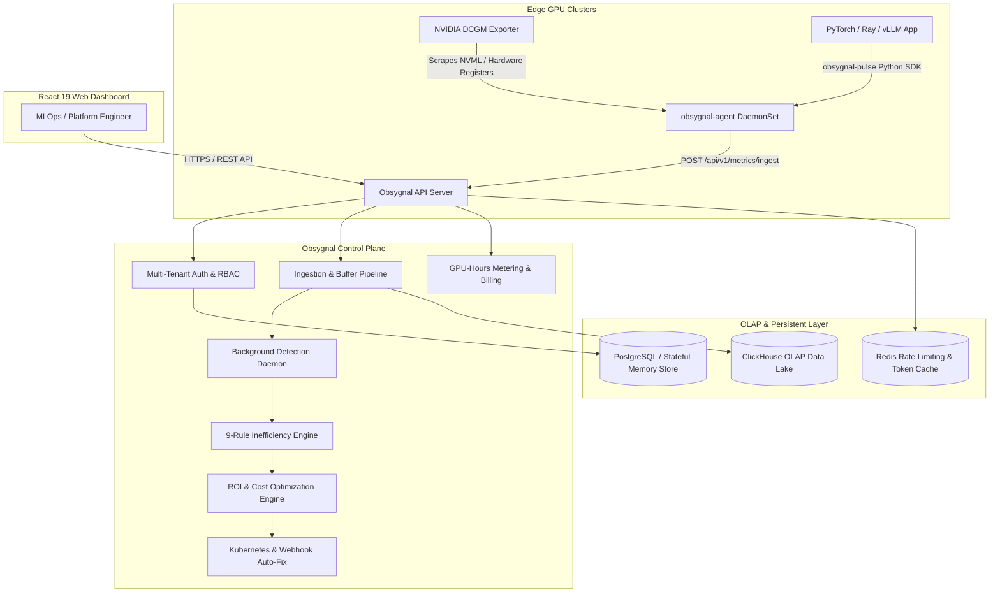

<div align="center">

# 🔥 Obsygnal-Pulse

### Real-Time GPU Observability, Telemetry & Cost Optimization Platform for AI/ML Infrastructure

[](https://github.com/sarkarbikram90/Obsygnal-Pulse/actions)
[](go.mod)
[](web/package.json)
[](LICENSE)
[](CODE_OF_CONDUCT.md)
[](CONTRIBUTING.md)

<p align="center">
  <b>Stop burning cloud GPU compute.</b> Detect idle allocations, PyTorch CUDA memory fragmentation, host CPU starvation, and hung distributed training loops with <b>1-click Kubernetes remediation</b>.
</p>

[Quickstart](#-quickstart) • [Architecture](#-architecture) • [Detection Rules](#-detection-engine-rules) • [Python SDK](#-python-sdk) • [API Reference](#-api-route-reference) • [Deployment](#-deployment) • [Contributing](CONTRIBUTING.md)

</div>

---

## 📖 Why Obsygnal-Pulse?

Modern AI teams spend millions on cloud GPU compute. At **$5.12/hour for an NVIDIA H100**, a standard 512-GPU cluster burns **$1.9M every month**. However, hyperscalers and MLOps teams regularly waste **20% to 40% of that budget** on:

- **Idle GPU Allocations**: Compute pods reserved in Kubernetes/Slurm but executing zero kernels.
- **PyTorch CUDA Allocator Fragmentation**: PyTorch reserves 70GB+ of VRAM while allocating only 20GB, leading to synthetic OOMs.
- **Host CPU Starvation**: GPUs idling at 0% while waiting for saturated CPU worker threads to finish data preprocessing.
- **Hung Distributed Training Loops**: NCCL collective deadlocks and stalled PyTorch/Ray training jobs consuming full power.
- **NVIDIA Hardware Faults**: Uncaught XID errors (XID 31, 43, 62, 79) and thermal degradation degrading cluster throughput.

Traditional cloud monitoring tools (Datadog, standard Grafana) only monitor surface-level CPU or generic utilization. **Obsygnal-Pulse** was engineered from the ground up for deep NVIDIA hardware primitives, AI framework profiling, and automated cost remediation.

---

## 🚀 Key Features

| Feature | Description |
| :--- | :--- |
| 📡 **Edge Telemetry Daemon (`obsygnal-agent`)** | Scrapes NVIDIA DCGM Prometheus exporters (`DCGM_FI_DEV_GPU_UTIL`, `DCGM_FI_DEV_FB_USED`, `DCGM_FI_DEV_GPU_TEMP`, `DCGM_FI_DEV_POWER_USAGE`) with NVLink, MIG, and XID error code extraction. |
| 🧠 **9-Rule Detection Engine** | Deterministic $O(n)$ evaluation of compute bottlenecks, memory fragmentation, thermal hazards, and hung jobs. |
| 💰 **Multi-Cloud ROI Engine** | Real pricing database (AWS, GCP, Azure, CoreWeave, Lambda Labs) for H200, B200, H100, A100, L40S, L4, RTX 4090 with hourly and monthly waste calculation. |
| ⚡ **1-Click Auto-Remediation** | Generates Kubernetes patch manifests, Helm overrides, or webhook actions to immediately recover wasted compute. |
| 🏢 **Multi-Tenant SaaS Control Plane** | JWT Bearer authentication, bcrypt password hashing, 5 RBAC roles (`viewer`, `operator`, `admin`, `billing`, `owner`), and machine API key tokens (`obsygnal_sec_...`). |
| 📊 **Modern React 19 Dashboard** | Dark-mode UI with live GPU heatmap, cluster overview, time-series charts, and interactive **Fleet ROI Simulator**. |
| 🐍 **1-Line Python SDK** | Developer-first `pip install obsygnal-pulse` with native PyTorch VRAM and Ray job profiling. |
| 🛡️ **SOC2 Audit Trail & Metering** | Complete immutable audit event logs and usage metering (monitored GPU-hours, node quotas). |
| 🔄 **Zero-Dependency Fallbacks** | Boots instantly with stateful in-memory repositories if ClickHouse or Redis are offline. |

---

## 🏛️ System Architecture

Obsygnal-Pulse follows **Hexagonal Architecture (Ports & Adapters)**, strictly separating domain logic from external infrastructure.



---

## 🧠 Detection Engine Rules

Obsygnal-Pulse evaluates **9 distinct inefficiency rules** across every ingested telemetry window:

| Rule Name | Severity | Detection Logic | Actionable Remediation |
| :--- | :---: | :--- | :--- |
| **Idle GPU** | `High` | 0% compute utilization + 0 active processes for > 10m | Release pod allocation or downscale cluster node |
| **Underutilized GPU** | `Medium` | Compute saturation < 20% over sustained window | Downscale instance (e.g. H100 → L40S) or consolidate |
| **Low Memory Usage** | `Medium` | GPU memory utilization < 15% of total VRAM | Enable Multi-Instance GPU (MIG) slicing |
| **CPU Starvation** | `High` | Host CPU > 90% while GPUs stall (< 10% compute) | Scale PyTorch DataLoader `num_workers` & pin memory |
| **Stalled Training** | `Critical` | Near-zero compute with > 30% memory allocated | Detect hung distributed rank; restart from checkpoint |
| **Thermal Spike** | `Critical` | GPU temperature > 83°C or throttling flag active | Reduce power cap via `nvidia-smi -pl` or check cooling |
| **XID Hardware Fault** | `Critical` | Hardware errors reported (XID 31, 43, 62, 79) | Cordon and drain Kubernetes node for RMA replacement |
| **CUDA Memory Frag** | `High` | PyTorch `reserved_bytes` >> `allocated_bytes` | Set `PYTORCH_CUDA_ALLOC_CONF=expandable_segments:True` |
| **KV Cache Saturation** | `High` | vLLM PagedAttention KV cache utilization > 90% | Enable chunked prefill or scale model replicas |

---

## ⚡ Quickstart

### Prerequisites
- **Go**: `1.24+`
- **Node.js**: `v20+` (for React dashboard)
- **Docker Compose**: (Optional, for ClickHouse & Redis)

### 1. Clone & Configure
```bash
git clone https://github.com/sarkarbikram90/Obsygnal-Pulse.git
cd Obsygnal-Pulse
cp .env.example .env
```

### 2. Start Full Local Stack with Docker Compose (Recommended)
```bash
make docker-up
```
This spins up ClickHouse (`:8123`), Redis (`:6379`), NATS (`:4222`), Prometheus (`:9090`), and Grafana (`:3000`).

### 3. Start Backend Control Plane API Server
```bash
go run ./cmd/api-server/main.go
```
*The server boots on `http://localhost:8080` with zero external dependencies via memory fallbacks if Docker is offline.*

### 4. Start Background Worker
```bash
go run ./cmd/worker/main.go
```

### 5. Start React Web Dashboard
```bash
cd web
npm install
npm run dev
```
Open [http://localhost:5173](http://localhost:5173) in your browser.

---

## 🐍 Python SDK

Install the SDK into your PyTorch, Ray, or vLLM training environment:

```bash
pip install obsygnal-pulse
```

### 1-Line Integration in PyTorch Training Scripts:
```python
import obsygnal

# Initializes background GPU and PyTorch VRAM auto-profiler
client = obsygnal.init(
    api_key="obsygnal_sec_your_api_key",
    endpoint="http://localhost:8080",
    cluster_id="us-east-h100-cluster"
)

# Training loop runs normally with automated telemetry streaming
for epoch in range(num_epochs):
    train_one_epoch()
```

---

## 🌐 API Route Reference

All public endpoints are versioned under `/api/v1/` following [SemVer 2.0.0](docs/api/versioning.md):

| Method | Endpoint | Description | Auth Required |
| :--- | :--- | :--- | :---: |
| `GET` | `/api/v1/health` | Liveness health check probe | Public |
| `GET` | `/api/v1/ready` | Readiness health check probe | Public |
| `POST` | `/api/v1/auth/register` | User registration & organization signup | Public |
| `POST` | `/api/v1/auth/login` | User authentication & JWT token issuance | Public |
| `GET` | `/api/v1/auth/me` | Current authenticated user & tenant context | Protected |
| `POST` | `/api/v1/metrics/ingest` | Ingest edge GPU telemetry batch | API Key / Token |
| `GET` | `/api/v1/cluster/overview` | Aggregated cluster health & GPU waste metrics | Protected |
| `GET` | `/api/v1/inefficiencies` | List detected GPU compute bottlenecks | Protected |
| `GET` | `/api/v1/recommendations` | Active recommendations with ROI savings | Protected |
| `POST` | `/api/v1/recommendations/:id/apply` | Execute 1-click auto-remediation | Protected |
| `POST` | `/api/v1/recommendations/:id/dismiss` | Dismiss recommendation with reason | Protected |
| `POST` | `/api/v1/api-keys` | Generate collector API key (`obsygnal_sec_...`) | Protected |
| `GET` | `/api/v1/billing/usage` | GPU-hours monitored & tier subscription quota | Protected |
| `GET` | `/api/v1/audit-logs` | SOC2 compliance audit log event history | Protected |
| `GET` | `/metrics` | Operational Prometheus metrics endpoint | Public |

*For complete request/response schemas, see the [API Reference Guide](docs/api/README.md).*

---

## 🚀 Deployment

### Deploy with Helm onto Kubernetes (GKE, EKS, AKS)
```bash
# 1. Add Helm repository
helm repo add obsygnal https://charts.obsygnal.io
helm repo update

# 2. Deploy Obsygnal-Pulse onto GPU cluster
helm install obsygnal-pulse deploy/helm/obsygnal-pulse \
  --namespace obsygnal-system \
  --create-namespace \
  --set secrets.jwtSecret="YOUR_ENTERPRISE_JWT_SECRET_32_BYTES" \
  --set secrets.clickhousePassword="YOUR_CLICKHOUSE_PASSWORD"
```

*For bare-metal Slurm deployments, Kustomize overlays, and Terraform GKE modules, see the [Kubernetes Deployment Guide](docs/deployment/kubernetes.md) and [Enterprise Integration Playbook](docs/ENTERPRISE_INTEGRATION.md).*

---

## 🧪 Testing & Quality Assurance

Obsygnal-Pulse maintains a rigorous automated testing strategy:

```bash
# Run unit tests across all packages
go test -v -short ./internal/...

# Run unit tests with race detection and statement coverage
go test -v -race -coverprofile=coverage.out -covermode=atomic ./internal/...

# Run end-to-end integration pipeline tests
go test -v ./test/e2e/...

# Run static linter suite
golangci-lint run ./...
```

---

## 📚 Documentation

- [Architecture Design & Principles](docs/architecture.md)
- [Enterprise Onboarding & Integration Playbook](docs/ENTERPRISE_INTEGRATION.md)
- [REST API Reference Guide](docs/api/README.md)
- [API Versioning Strategy](docs/api/versioning.md)
- [Kubernetes & Helm Deployment Guide](docs/deployment/kubernetes.md)
- [GPU Alert Investigation Runbooks](docs/runbooks/gpu-alerts.md)
- [ClickHouse Storage Architecture Decision Record (ADR-001)](docs/adr/001-clickhouse-storage.md)

---

## 🤝 Contributing

We welcome community contributions! Please read our [Contributing Guide](CONTRIBUTING.md) and [Code of Conduct](CODE_OF_CONDUCT.md) before submitting a Pull Request.

---

## 🔒 Security

For vulnerability reporting and our coordinated disclosure policy, please see [SECURITY.md](SECURITY.md) or email [security@obsygnal.io](mailto:security@obsygnal.io).

---

## 📄 License

Obsygnal-Pulse is licensed under the [MIT License](LICENSE).
