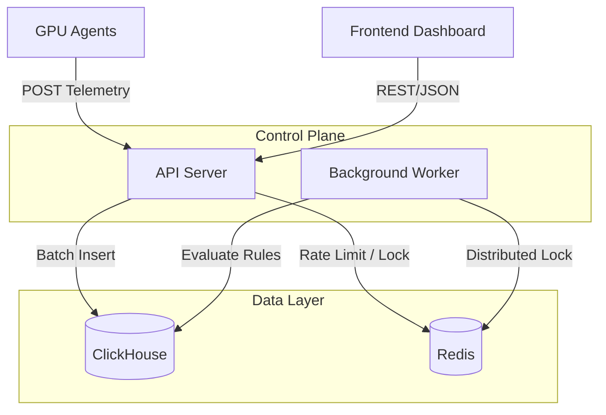

# 🔥 Obsygnal-Pulse

**AI Infrastructure Efficiency Platform** — Detect wasted GPU compute, optimize training workloads, save money.

[](https://github.com/sarkarbikram90/Obsygnal-Pulse/actions)

---

## 📖 Project Overview

Obsygnal-Pulse is an enterprise-grade observability and intelligence platform that monitors GPU clusters running AI/ML workloads. It ingests high-volume GPU telemetry, detects inefficiencies (idle GPUs, underutilized memory, stalled training loops), and provides actionable optimization recommendations with confidence scores and estimated cost savings.

## 🏛️ Architecture Overview

The backend is built around a **Hexagonal Architecture (Ports and Adapters)**, ensuring the core domain is completely decoupled from infrastructure concerns (HTTP, ClickHouse, Redis). 



## 🛠️ Tech Stack

- **Backend Development**: Go 1.26, Gin (HTTP)
- **Frontend SPA**: React 19, TypeScript, TailwindCSS v4, Vite, Recharts
- **OLAP Storage**: ClickHouse (Time-series telemetry and aggregations)
- **KV Storage**: Redis (Caching, Rate Limiting, Deduplication locks)
- **Infrastructure**: Docker, Kubernetes, Helm, Terraform
- **Observability**: Prometheus, Grafana, OpenTelemetry (WIP)

## 🚀 Local Setup

**Prerequisites:** Go 1.26+, Node.js 22+, Docker & Docker Compose, Make.

```bash
# 1. Clone & Configure
git clone https://github.com/sarkarbikram90/Obsygnal-Pulse.git
cd Obsygnal-Pulse
cp .env.example .env
make setup

# 2. Start Infrastructure (ClickHouse & Redis)
make docker-up

# 3. Apply Database Migrations
make migrate-docker

# 4. Start API Server (localhost:8080)
make dev

# 5. Start Telemetry Simulator (in another terminal)
make dev-simulator

# 6. Start React Frontend (localhost:5173)
cd web && npm install && npm run dev
```

*Note: To run without Docker, install ClickHouse and Redis natively and use `clickhouse-client` for migrations.*

## 🚢 Deployment Setup

The application is containerized and designed for Kubernetes deployment.
- **Dockerfiles**: Located in `deploy/docker/` (Alpine, non-root).
- **Environment Variables**: Managed via `.env` (dev) or Kubernetes Secrets/ConfigMaps (prod).
- **Stateless**: Both `api-server` and `worker` binaries are strictly stateless and can be autoscaled horizontally using HPA/KEDA.

## 🔭 Observability Stack

- **Metrics**: `api-server` exposes `/api/v1/health` and `/api/v1/ready`. Prometheus `/metrics` endpoints are planned.
- **Logging**: High-performance structured JSON logging via `zerolog`.
- **Tracing**: Request IDs are injected via middleware (`X-Request-ID`) and threaded through logs. Full OpenTelemetry span propagation is on the roadmap.

## 🧪 Testing Strategy

Our testing philosophy strictly separates unit tests (mocked I/O) from integration tests (real I/O).
- **Unit Tests**: 100% mocked infrastructure. `go test -short ./internal/...`
- **Integration Tests**: Tested against real ClickHouse and Redis instances. `go test -tags=integration ./test/integration/...`
- **Frontend Tests**: Vitest + React Testing Library (WIP).
- **Run all tests**: `make test`

## 🔄 CI/CD Overview

GitHub Actions (`.github/workflows/ci.yml`) enforces the following gates on every Pull Request:
1. `go vet` and `gofmt` to enforce code quality.
2. Go Test suite execution against all packages.
3. Node dependencies installation and ESLint validation for the frontend.
4. Docker build validation to ensure `api-server` and `worker` compile cleanly.

## 🛡️ Security Overview

- **Authentication**: JWT Bearer token authentication secures all internal API endpoints (`auth.go`).
- **Rate Limiting**: Sliding-window Redis rate limiter protects ingestion and query endpoints against abuse (`ratelimit.go`).
- **Data Safety**: Prepared statements in ClickHouse prevent SQL Injection. CORS and Security Headers are strictly defined in `middleware.go`.

## 📈 Scaling Roadmap

1. **Distributed Workers**: Migrate `worker` to use Redis-backed distributed locks (`redis-lock`) to allow multiple workers to safely evaluate rules concurrently without duplicating alerts.
2. **Pagination**: Implement cursor-based pagination for large data queries (e.g., `/gpus/metrics`).
3. **Queueing**: Introduce NATS JetStream or Kafka between the API Server and ClickHouse to handle massive telemetry bursts beyond memory buffer capacities.

## ⚙️ Operational Maturity Roadmap

1. **OpenTelemetry Integration**: Instrument the ClickHouse driver and HTTP router with OpenTelemetry for distributed tracing.
2. **Self-Monitoring**: Add Prometheus metrics tracking ingestion batch sizes, DB query latencies, and HTTP response codes.
3. **Runbooks**: Document incident recovery procedures for ClickHouse partition failures or Redis OOM events.

---

*This repository follows standard Go project layout and clean architecture patterns.*
