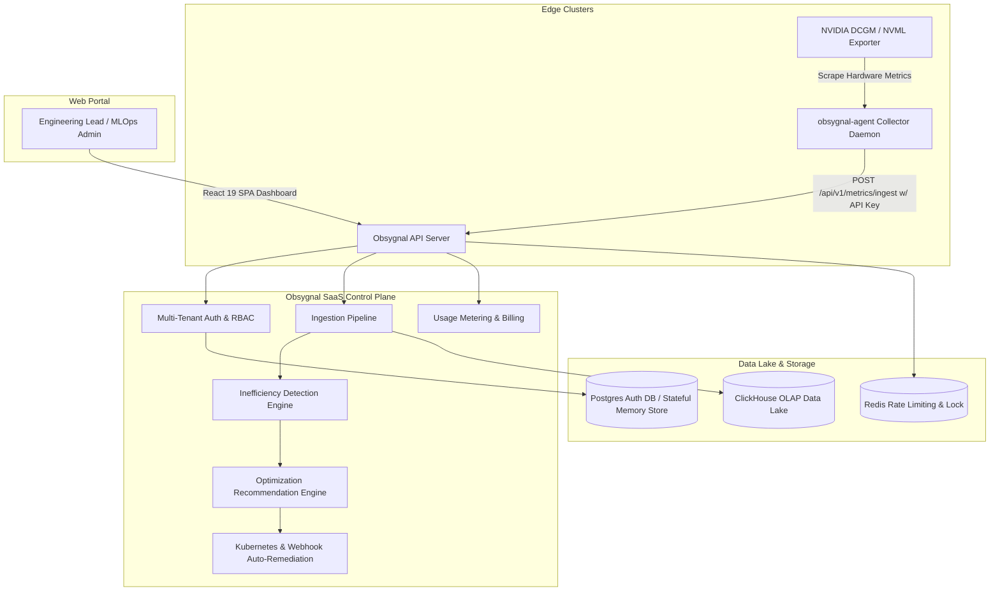

# 🔥 Obsygnal-Pulse

**Market-Ready AI Infrastructure Efficiency & GPU Optimization SaaS Platform** — Stop wasting cloud GPU compute, optimize PyTorch/Ray training workloads, and reduce cluster costs by up to 40%.

[](https://github.com/sarkarbikram90/Obsygnal-Pulse/actions)
[](LICENSE)
[](go.mod)
[](web/package.json)

---

## 📖 Product Overview

**Obsygnal-Pulse** is an enterprise-grade, multi-tenant B2B SaaS platform that provides real-time observability, intelligence, and automated remediation for GPU clusters running AI/ML workloads (PyTorch, Ray, vLLM, DeepSpeed, Megatron-LM).

It ingests high-frequency edge GPU telemetry via a lightweight node daemon (`obsygnal-agent`), evaluates mathematical inefficiency rules (idle GPUs, underutilized VRAM, host CPU bottlenecks, hung training loops), calculates monetary waste against multi-cloud pricing databases (AWS, GCP, Azure, CoreWeave, Lambda Labs), and provides **1-click Kubernetes auto-remediation**.

---

## 🚀 Key SaaS Platform Features

- 🏢 **Multi-Tenant Workspace Isolation**: Enterprise tenant boundaries with organization switching, JWT authentication, and fine-grained RBAC (`owner`, `admin`, `operator`, `viewer`).
- 🔑 **Cluster Agent API Keys**: Secure machine-to-machine key generation (`obsygnal_sec_...`) for edge telemetry collectors.
- 📡 **Edge Telemetry Daemon (`obsygnal-agent`)**: Scrapes NVIDIA DCGM Prometheus exporters (`DCGM_FI_DEV_GPU_UTIL`, `DCGM_FI_DEV_FB_USED`, `DCGM_FI_DEV_GPU_TEMP`, `DCGM_FI_DEV_POWER_USAGE`) and streams batched metrics securely.
- 🧠 **Inefficiency Detection Engine**: Real-time evaluation of:
  - **Idle GPUs**: 0% compute utilization while accumulating cloud instance costs.
  - **Underutilized GPUs**: Low compute saturation below configurable thresholds.
  - **CPU Starvation**: Host CPU pegged at >90% while GPUs stall on data preprocessing.
  - **Stalled Training Loops**: Hung PyTorch/Ray distributed training deadlocks with memory allocated but zero compute.
  - **Thermal Spikes**: Critical temperature exceeding safe hardware thresholds.
- ⚡ **1-Click Auto-Remediation**: Instant generation of Kubernetes YAML repair manifests, Helm commands, or webhook actions to downscale idle pods.
- 💳 **Usage Metering & Tiered Billing**: Track monthly GPU-hours monitored, active cluster nodes, and tier quotas (Free, Growth Pro, Enterprise).
- 💾 **Stateful Memory & OLAP Data Layer**: High-throughput ClickHouse OLAP storage for time-series analytics with resilient, thread-safe in-memory fallback repositories.
- 🛡️ **SOC2 Compliance Audit Trail**: Comprehensive audit event logging for enterprise governance.

---

## 🏛️ System Architecture Overview



---

## 🛠️ Tech Stack

- **Backend Control Plane**: Go 1.26, Gin Web Framework, Zerolog.
- **Frontend SPA Portal**: React 19, TypeScript, TailwindCSS v4, Vite, TanStack Query, Lucide Icons, Recharts.
- **Data Lake (OLAP)**: ClickHouse (Time-series telemetry & aggregated views).
- **Relational & KV Storage**: PostgreSQL (Multi-tenant auth, RBAC, API keys), Redis (Rate limiting, sliding windows).
- **Edge Collector**: Go DaemonSet / Prometheus DCGM Exporter Scraper.
- **Infrastructure**: Docker, Kubernetes, Helm, Terraform.

---

## ⚡ Quickstart & Local Setup

### Prerequisites
- **Go**: `1.26+`
- **Node.js**: `v22+`
- **Docker & Docker Compose**: (Optional, for ClickHouse & Redis)

### 1. Clone & Configure
```bash
git clone https://github.com/sarkarbikram90/Obsygnal-Pulse.git
cd Obsygnal-Pulse
cp .env.example .env
```

### 2. Start API Control Plane (localhost:8080)
```bash
go run ./cmd/api-server/main.go
```
*Note: If ClickHouse or Redis are offline, the API server seamlessly initializes stateful in-memory repositories for instant evaluation.*

### 3. Start Telemetry Edge Collector
```bash
go run ./cmd/collector/main.go
```

### 4. Start React SaaS Dashboard (localhost:5173)
```bash
cd web
npm install
npm run dev
```

---

## 🌐 API Route Reference

| Method | Endpoint | Description | Auth |
| :--- | :--- | :--- | :--- |
| `GET` | `/api/v1/health` | Health check probe | Public |
| `POST` | `/api/v1/auth/register` | Tenant signup & organization creation | Public |
| `POST` | `/api/v1/auth/login` | User login & JWT token issuance | Public |
| `POST` | `/api/v1/metrics/ingest` | Ingest edge GPU telemetry batch | API Key / Public |
| `GET` | `/api/v1/cluster/overview` | Aggregated cluster health & GPU waste metrics | Protected |
| `GET` | `/api/v1/inefficiencies` | List active GPU compute bottlenecks | Protected |
| `GET` | `/api/v1/recommendations` | Active recommendations with ROI cost savings | Protected |
| `POST` | `/api/v1/recommendations/:id/apply` | Trigger 1-click auto-remediation | Protected |
| `POST` | `/api/v1/recommendations/:id/dismiss` | Dismiss recommendation with reason | Protected |
| `POST` | `/api/v1/api-keys` | Generate collector API key (`obsygnal_sec_...`) | Protected |
| `GET` | `/api/v1/billing/usage` | GPU-hours monitored & subscription quota | Protected |
| `GET` | `/api/v1/audit-logs` | SOC2 compliance audit log event history | Protected |

---

## 🧪 Comprehensive Testing & E2E Suite

The codebase includes full unit, HTTP handler, and end-to-end integration test suites:

- **Unit Tests**: Test rule evaluations, JWT auth, and metric models.
  ```bash
  go test -short ./internal/...
  ```

- **HTTP Handler Tests**: Test REST API responses for auth, recommendations, and billing.
  ```bash
  go test ./internal/api/handlers/...
  ```

- **End-to-End (E2E) Pipeline Test**: Test the complete flow (Metric Ingestion -> Detection -> Recommendation -> Auto-Remediation -> Billing Metering).
  ```bash
  go test ./test/e2e/...
  ```

---

## 🛡️ Security & Enterprise Compliance

- **Multi-Tenant Isolation**: Requests are strictly scoped to the tenant's `org_id` via JWT claims or machine API keys.
- **Machine Authentication**: Edge collectors authenticate with prefix-validated secret keys (`obsygnal_sec_`).
- **Data Protection**: Prepared statements prevent SQL injection. CORS, Security Headers, and Redis sliding-window rate limiting protect endpoints against abuse.
- **SOC2 Audit Trail**: Implemented `audit_events` logging for infrastructure modification actions.

---

## 📄 License

Distributed under the MIT License. See `LICENSE` for details.
