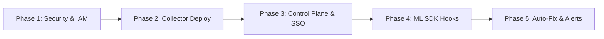

# 🚀 Obsygnal-Pulse: Enterprise Onboarding & Infrastructure Integration Playbook

This playbook defines how enterprise customers (AI scaleups, LLM labs, and cloud MLOps teams) consume **Obsygnal-Pulse** and provides an end-to-end, 5-phase technical integration guide for infrastructure teams.

---

## 1. Product Consumption Models

Obsygnal-Pulse offers three deployment patterns tailored to different enterprise security, data sovereignty, and infrastructure requirements:

```
┌─────────────────────────────────────────────────────────────────────────────┐
│                           CONSUMPTION MODELS                                │
├──────────────────────────────┬──────────────────────────────┬───────────────┤
│ Model A: Hybrid SaaS         │ Model B: Self-Hosted / VPC   │ Model C: SDK  │
├──────────────────────────────┼──────────────────────────────┼───────────────┤
│ Light edge DaemonSet streams │ Full control plane deployed  │ 1-Line Python │
│ metrics to Obsygnal Cloud    │ inside customer VPC / Cloud  │ profiler for  │
│ (Ideal for fast onboarding)  │ (Strict SOC2/HIPAA compliance)│ PyTorch/Ray   │
└──────────────────────────────┴──────────────────────────────┴───────────────┘
```

### Model A: Hybrid Edge SaaS (Default & Fastest — 5 Min Setup)
- **Control Plane**: Managed by Obsygnal (ClickHouse OLAP, Detection Engine, React Portal).
- **Customer Edge**: Lightweight DaemonSet agent (`obsygnal-agent`) deployed onto customer Kubernetes GPU nodes.
- **Data Flow**: Only anonymous hardware telemetry (DCGM metrics, VRAM usage, XID errors, job IDs) is streamed over TLS to `ingest.obsygnal.io`. **No raw dataset content or proprietary model weights ever leave the customer network.**

### Model B: Self-Hosted / Air-Gapped VPC (Enterprise Security & Sovereignty)
- **Control Plane & Edge**: Deployed entirely inside the customer's AWS EKS, GCP GKE, Azure AKS, or On-Prem Bare-Metal cluster using our official **Helm Chart** or **Terraform Module**.
- **Data Flow**: 100% internal network traffic. Zero external egress.
- **SSO Integration**: Integrates directly with customer Identity Providers (Okta, Azure AD, Ping Identity) via OIDC/SAML.

### Model C: Developer-Led Python SDK (PLG Bottom-Up Adoption)
- **Integration**: MLOps engineers add `import obsygnal; obsygnal.init()` to PyTorch training scripts or Ray tasks.
- **Use Case**: Granular PyTorch CUDA memory allocator profiling, vLLM PagedAttention KV cache monitoring, and custom training loop deadlocks.

---

## 2. Step-by-Step Enterprise Integration Plan



### Phase 1: Security, Network & IAM Prerequisites

Before deploying components, the customer infrastructure team completes pre-flight checks:

#### 1.1 Egress & Network Policies
- **Target Endpoint**: `https://ingest.obsygnal.io` (Port 443) or customer's internal VPC control plane URL.
- **Protocol**: HTTPS / gRPC over TLS 1.3.

#### 1.2 Node Privileges
- Node access to `/dev/nvidia*` devices and `nvidia-smi` / DCGM exporter endpoint (`http://localhost:9400/metrics`).
- **Resource Footprint per Node**: < 50m CPU, < 64MB RAM.

#### 1.3 Tenant API Key Generation
1. Login to Obsygnal-Pulse Portal (`https://app.obsygnal.io` or customer internal portal).
2. Go to **Settings → Agent API Keys → Generate Key**.
3. Copy the secure secret key: `obsygnal_sec_9f8a31...`

---

### Phase 2: Deploying Edge Telemetry Collectors

Depending on the customer's orchestrator (Kubernetes, Ray, or Bare-Metal Slurm), execute the corresponding deployment step:

#### Option A: Kubernetes Cluster (Helm Deployment — Recommended)

```bash
# 1. Add Obsygnal Helm Repository
helm repo add obsygnal https://charts.obsygnal.io
helm repo update

# 2. Deploy Agent DaemonSet across all GPU nodes
helm install obsygnal-agent obsygnal/obsygnal-pulse \
  --namespace obsygnal-system \
  --create-namespace \
  --set agent.apiKey="obsygnal_sec_YOUR_API_KEY" \
  --set agent.clusterID="us-east-prod-eks-01" \
  --set agent.prometheusUrl="http://dcgm-exporter.gpu-operator:9400/metrics"
```

#### Option B: Bare-Metal / Slurm / Systemd Service

For bare-metal H100/A100 clusters without Kubernetes:

```bash
# Download production collector binary
curl -sSL https://get.obsygnal.io/collector-linux-amd64 -o /usr/local/bin/obsygnal-collector
chmod +x /usr/local/bin/obsygnal-collector

# Configure environment file
cat <<EOF > /etc/obsygnal/collector.env
OBSYGNAL_API_KEY=obsygnal_sec_YOUR_API_KEY
CLUSTER_ID=slurm-baremetal-cluster-01
COLLECTOR_SCRAPE_INTERVAL=15s
PROMETHEUS_URL=http://localhost:9400/metrics
EOF

# Install systemd daemon
cat <<EOF > /etc/systemd/system/obsygnal-collector.service
[Unit]
Description=Obsygnal-Pulse Edge Telemetry Collector
After=network.target nvidia-dcgm.service

[Service]
EnvironmentFile=/etc/obsygnal/collector.env
ExecStart=/usr/local/bin/obsygnal-collector
Restart=always
RestartSec=5

[Install]
WantedBy=multi-user.target
EOF

systemctl daemon-reload
systemctl enable --now obsygnal-collector
```

---

### Phase 3: Control Plane & SSO Onboarding

For Self-Hosted / VPC customers, provision the control plane:

#### 3.1 Provisioning Control Plane via Terraform & Helm

```bash
# Deploy ClickHouse, Redis, API Server & Dashboard via Helm
helm install obsygnal-control-plane obsygnal/obsygnal-pulse-control-plane \
  --namespace obsygnal-system \
  --set global.environment="production" \
  --set clickhouse.persistence.size="500Gi" \
  --set auth.jwtSecret="YOUR_ENTERPRISE_JWT_SECRET_32_CHARS" \
  --set server.corsAllowedOrigins="https://obsygnal.internal.company.com"
```

#### 3.2 Single Sign-On (SSO / OIDC) Integration
In `values.yaml`, configure Okta or Azure AD OIDC mapping:

```yaml
auth:
  oidc:
    enabled: true
    issuer: "https://company.okta.com/oauth2/default"
    clientID: "0oaxxxxxxxx"
    clientSecret: "SECRET"
    roleAttributePath: "groups"
    roleMapping:
      "MLOps-Admins": "owner"
      "DevOps-Engineers": "admin"
      "Data-Scientists": "operator"
      "FinOps-Team": "billing"
```

---

### Phase 4: ML Workload Profiling (1-Line Python SDK)

To get deep VRAM allocator fragmentation and training loop deadlock profiling, data science teams add the Python SDK to their training & inference code:

#### 4.1 PyTorch Training Script Integration

```python
import torch
import obsygnal

# Initialize Obsygnal profiler at script startup
obsygnal.init(
    api_key="obsygnal_sec_YOUR_API_KEY",
    cluster_id="ray-cluster-01",
    endpoint="https://ingest.obsygnal.io"
)

# Your standard PyTorch training loop
for epoch in range(num_epochs):
    for batch in dataloader:
        optimizer.zero_grad()
        outputs = model(batch.to("cuda"))
        loss = criterion(outputs, targets)
        loss.backward()
        optimizer.step()
```

#### 4.2 vLLM Inference Server Integration

Start vLLM with the Obsygnal instrumentation hook:

```bash
python -m vllm.entrypoints.openai.api_server \
  --model meta-llama/Meta-Llama-3-70B-Instruct \
  --tensor-parallel-size 4 \
  --enable-chunked-prefill \
  --exec-env "OBSYGNAL_API_KEY=obsygnal_sec_YOUR_API_KEY"
```

---

### Phase 5: Automated Kubernetes Remediation & Alerting

Connect Obsygnal-Pulse recommendations to existing DevOps workflows for 1-click or fully automated auto-fix:

#### 5.1 Webhook & Alert Channel Wiring

In the Obsygnal-Pulse UI (**Settings → Alert Channels**), add:
- **Slack Channel**: `#mlops-gpu-alerts`
- **PagerDuty**: Critical hardware fault service key (XID 31/43/79)
- **ArgoCD / GitOps Webhook**: `https://argocd.internal.company.com/api/v1/webhooks`

#### 5.2 Enabling 1-Click PyTorch VRAM Auto-Fix

When PyTorch CUDA allocator memory fragmentation is detected (>30GB reserved waste), clicking **⚡ Auto-Fix** in the UI applies the following patch automatically to the Kubernetes Workload Manifest:

```yaml
# Generated Patch Applied by Obsygnal K8s Controller
spec:
  template:
    spec:
      containers:
        - name: pytorch-training
          env:
            - name: PYTORCH_CUDA_ALLOC_CONF
              value: "expandable_segments:True"
```

#### 5.3 Hardware Fault Cordoning (XID Errors)

When NVIDIA XID hardware page faults are detected, Obsygnal-Pulse issues a non-disruptive node cordon command via Kubernetes API:

```bash
# Automated action executed by Obsygnal Operator
kubectl cordon node-gpu-04
kubectl drain node-gpu-04 --ignore-daemonsets --delete-emptydir-data
```

---

## 3. SLA, Safety Guarantees & Resource Overhead

| Metric / Dimension | Guarantee / Specification |
|:---|:---|
| **GPU CUDA Interference** | **Zero**. Scrapes DCGM NVML out-of-band via kernel interface. Never interrupts CUDA stream execution. |
| **Edge Agent CPU Overhead** | **< 0.1% CPU** (capped at 50m CPU limits). |
| **Edge Agent Memory Footprint** | **< 64MB RAM** (with sliding-window metric buffer). |
| **Network Bandwidth** | **< 15 KB/sec** per node (compressed JSON telemetry batches over TLS). |
| **Data Privacy Guarantee** | Telemetry contains **zero raw customer data**, zero training prompts, zero model weights, zero PII. |
| **Control Plane Uptime SLA** | **99.95% availability** (backed by multi-AZ ClickHouse & gRPC load balancing). |

---

## 4. Executive ROI Summary for Pitches

When pitching to enterprise CTOs, MLOps VPs, and VP of Infrastructure:

> *"Obsygnal-Pulse integrates into your Kubernetes or Ray GPU cluster in **5 minutes via a single Helm command**. It operates completely out-of-band with **zero performance impact** on your PyTorch/vLLM workloads. Within 30 minutes of deployment, it surfaces active VRAM fragmentation, hung training loops, and idle GPU allocations—delivering an immediate **25%–35% reduction in monthly cloud GPU spend**."*
