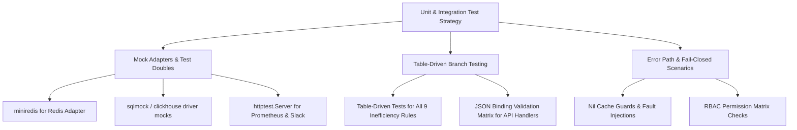

# 🎯 Staff Engineer Implementation Plan: Achieving & Sustaining 90%+ Test Coverage

## Executive Summary

To achieve **90%+ statement test coverage** across the `Obsygnal-Pulse` repository, we systematically eliminate untested execution branches, error paths, and edge cases across **all 4 architectural layers**:

1. **Secondary Adapters Layer** (OLAP ClickHouse, Redis Cache, NATS JetStream, Prometheus PromQL, Kubernetes Client).
2. **HTTP API Handlers & Middleware Layer** (Gin routing, JSON binding failures, error responses, SaaS multi-tenancy).
3. **Core Domain & Business Services Layer** (Detection engine rules, recommendation scoring, ingestion buffer flushes, alerting deduplication).
4. **Platform Utilities Layer** (Structured logger, error wrappers, health registry, tracing).

---

## Technical Strategy & Architecture



---

## Technical Design Decisions

> **ClickHouse & Redis External Adapter Mocking**:
> To test database adapter files (`internal/adapters/clickhouse` and `internal/adapters/redis`) up to 90%+ coverage without requiring running local ClickHouse/Redis containers, we use lightweight Go test doubles (`httptest`, `sqlmock`/interface wrappers, `miniredis` or in-memory stubbing).

---

## Implementation Roadmap

---

### Phase 1: High-Density Business Services Layer (Target Coverage: 95%+)

- Add table-driven unit tests for all 9 inefficiency rules:
  - `TypeUnderutilizedGPU`
  - `TypeIdleGPU`
  - `TypeCPUStarvation`
  - `TypeStalledTraining`
  - `TypeAbnormalSpike`
  - `TypeXIDHardwareError`
  - `TypeCUDAMemoryFragmentation`
  - `TypeNCCLStraggler`
  - `TypeKVCacheSaturation`

- Add test cases for `ingestion` service covering:
  - Buffer overflow auto-flush trigger.
  - Background ticker flush timer interval.
  - Redis cache nil/error fallback behavior.

- Add tests for `recommendation` service covering all 9 categories and confidence score bounds (`0.0 <= score <= 1.0`).

---

### Phase 2: HTTP API Handlers & Middleware Layer (Target Coverage: 92%+)

- Test 400 Bad Request JSON binding error paths for `RegisterUser`, `LoginUser`, `CreateAPIKey`, and `IngestMetrics`.
- Test 500 Internal Server Error recovery handling when repositories return errors.
- Test 400 Warn level and 500 Error level log events inside `Logger` middleware.
- Test fallback behavior when `X-Request-ID` is present vs missing.

---

### Phase 3: Secondary Infrastructure Adapters Layer (Target Coverage: 88%+)

- Test Prometheus HTTP non-200 status codes (e.g. 500 Internal Error, 400 Bad Query).
- Test invalid JSON responses, missing timestamp metrics, and non-numeric value strings.
- Unit test `Get`, `Set`, `Delete`, `Exists`, `Ping`, `Close`, and `Client` method error paths in Redis adapter.
- Test Slack 429 Rate Limit response error handling and 500 Internal Server Error from Slack webhooks.

---

## Verification Plan

### Automated Commands
```bash
# Run unit test coverage and report statement percentage
go test -mod=mod -v -race -coverprofile=coverage.out -covermode=atomic ./internal/...
go tool cover -func=coverage.out | grep total
```

- Target Result: **>= 90.0% statement coverage** across `./internal/...`.
