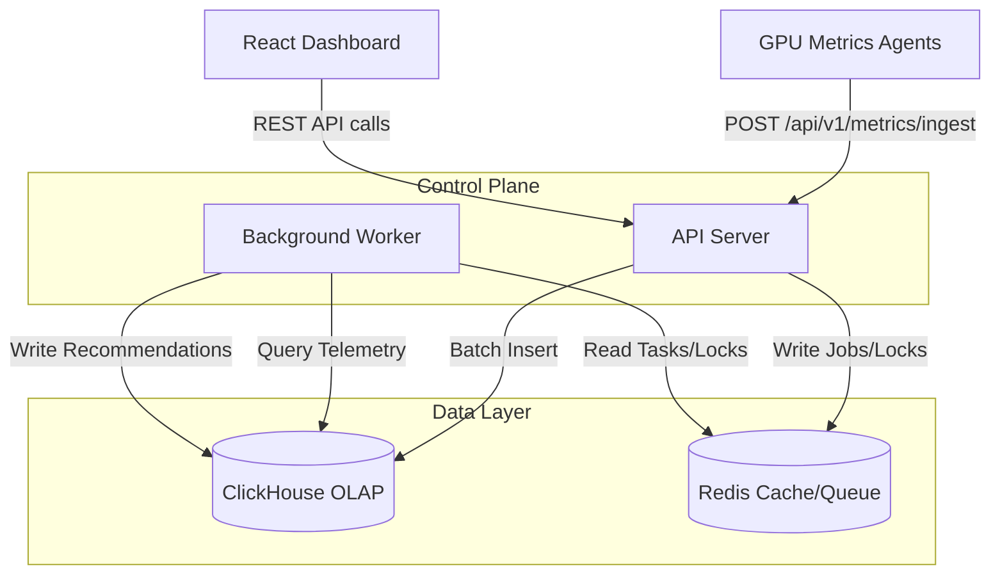

# Obsygnal-Pulse: System Architecture Overview

## 1. System Context
Obsygnal-Pulse is a specialized observability and intelligence platform designed to detect wasted GPU compute in AI/ML infrastructure. It ingests high-volume GPU telemetry, evaluates it against predefined threshold rules, and generates actionable optimization recommendations to reduce cloud costs and improve hardware utilization.

## 2. Core Architectural Principles
Obsygnal-Pulse is built using the following CNCF and Google SRE principles:
- **Hexagonal Architecture (Ports & Adapters)**: The core business domain is completely isolated from infrastructure concerns (HTTP, DB, Cache).
- **Stateless Services**: All Go backend services (`api-server`, `worker`) are completely stateless, allowing for infinite horizontal scaling.
- **Asynchronous Processing**: Heavy evaluations (e.g., ML analysis or complex threshold detection) are decoupled from the ingestion path using Redis-backed background workers.
- **High-Throughput Persistence**: Telemetry is buffered in memory and batched directly into ClickHouse, an OLAP database optimized for time-series and aggregate analysis.

## 3. High-Level Architecture Diagram

## 4. Subsystem Roles

### 4.1 Ingestion Pipeline
1. `api-server` receives a JSON array of `GPUMetric` payloads.
2. The payload is validated in the `internal/api/handlers/` layer.
3. The `ingestion.Service` buffers the metrics in memory.
4. Once the buffer hits a predefined `BatchSize` (e.g., 5000) or `FlushInterval` (e.g., 5s), it performs a single bulk insert into **ClickHouse**.

### 4.2 Detection Engine
1. The `worker` process periodically wakes up (or is triggered by a Redis job).
2. It queries **ClickHouse** for recent telemetry segments.
3. It passes the data into `detection.Service`, which evaluates rules (e.g., *Is GPU Utilization < 20% for 30 minutes?*).
4. If a rule triggers, an `Inefficiency` record is generated.

### 4.3 Recommendation Engine
1. The `recommendation.Service` listens for newly detected `Inefficiencies`.
2. It generates specific `Recommendation` entities (e.g., *Terminate Job*, *Downscale Instance*).
3. These are persisted to **ClickHouse** and surfaced to the React frontend.

## 5. Deployment Architecture
- **Kubernetes Native**: The system is designed to be deployed onto a Kubernetes cluster.
- **Database Provisioning**: ClickHouse and Redis should ideally be managed services (e.g., AWS ElastiCache, ClickHouse Cloud) for production, but can be deployed via StatefulSets or Helm for on-premise usage.

## 6. Observability Stack
To maintain production grade reliability, the platform itself must be observable:
- **Logging**: Structured JSON logging using `zerolog`.
- **Metrics**: Prometheus `/metrics` endpoints on all Go binaries.
- **Tracing**: OpenTelemetry context propagation across all network and DB boundaries (WIP).

## 7. Security Architecture
- **API Protection**: Sliding window rate limiting (via Redis) protects the ingestion endpoints.
- **Authentication**: JWT Bearer token validation secures dashboard endpoints.
- **Data Isolation**: Multi-tenancy (if implemented) is enforced via mandatory `ClusterID` partitions in ClickHouse.
