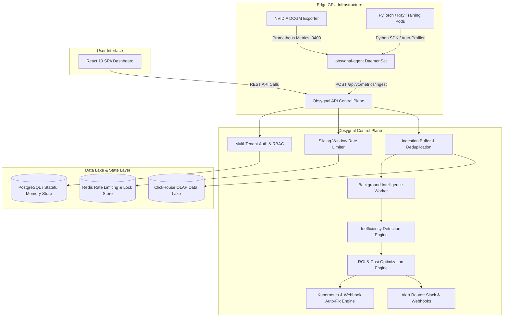

# Obsygnal-Pulse: System Architecture & Technical Specifications

## 1. System Context & Overview

**Obsygnal-Pulse** is an enterprise-grade observability and cost-optimization platform engineered specifically for GPU-accelerated AI infrastructure. It ingests high-frequency telemetry from NVIDIA hardware, evaluates deterministic inefficiency rules, quantifies monetary compute waste against multi-cloud pricing models, and provides 1-click automated remediation for Kubernetes clusters.

---

## 2. Core Architectural Principles

Obsygnal-Pulse is built using modern cloud-native and CNCF principles:

- **Hexagonal Architecture (Ports & Adapters)**: The core business domain and evaluation engines are strictly decoupled from infrastructure layers (ClickHouse, Redis, Prometheus, NATS, Gin).
- **Zero-Dependency Resilience**: Control plane services boot and operate cleanly with thread-safe in-memory fallbacks if persistent storage is temporarily unavailable.
- **High-Throughput Ingestion**: Edge telemetry is buffered in memory and batched directly into ClickHouse OLAP storage for low latency and high insertion throughput.
- **Deterministic Rule Evaluation**: Inefficiency rules are implemented as fast, interpretable, deterministic $O(n)$ functions with explicit confidence scoring.
- **Strict Multi-Tenancy & RBAC**: Requests are isolated by tenant organization ID with JWT claims and machine API keys.

---

## 3. High-Level System Architecture

---

## 4. Subsystem Specifications

### 4.1 Ingestion Pipeline
1. `api-server` receives a JSON batch of `GPUMetric` and `NodeMetric` records from edge agents or Python SDK clients.
2. The payload is validated against struct tags in `internal/api/dto/`.
3. Ingested records are placed into an in-memory buffer protected by `sync.RWMutex`.
4. When the buffer reaches `CLICKHOUSE_BATCH_SIZE` (default: 10,000) or `CLICKHOUSE_FLUSH_INTERVAL` (default: 5s), a batch insert is executed against ClickHouse.

### 4.2 Detection Engine
1. The background worker queries recent telemetry windows from ClickHouse (or memory repository).
2. It executes the **9 Detection Rules**:
   - `idle_gpu`
   - `underutilized_gpu`
   - `low_memory_usage`
   - `cpu_starvation`
   - `stalled_training`
   - `abnormal_resource_spike`
   - `xid_hardware_error`
   - `cuda_memory_fragmentation`
   - `kv_cache_saturation`
3. If an anomaly violates threshold criteria, an `Inefficiency` entity is generated with severity and diagnostic metadata.

### 4.3 Recommendation & Remediation Engine
1. Newly detected `Inefficiency` records trigger the `recommendation.Service`.
2. The engine calculates confidence scores ($0.0 \le \text{score} \le 1.0$) and monetary waste ($/hr and $/mo) against multi-cloud GPU pricing tables.
3. Actionable remediation payloads (e.g. Kubernetes YAML patch, Helm command, or webhook trigger) are attached to the recommendation.

### 4.4 Multi-Tenant Authentication & RBAC
1. User registration creates an `Organization` and initial `User` with `owner` role.
2. Password hashes are generated using `bcrypt` (configurable cost, default: 12).
3. JWT tokens contain `user_id`, `org_id`, and `role` claims.
4. RBAC middleware strictly enforces permissions across 5 roles: `viewer`, `operator`, `admin`, `billing`, and `owner`.
5. Edge collectors authenticate via `obsygnal_sec_...` machine API keys hashed with SHA-256.

---

## 5. Deployment Topologies

- **Hybrid Edge SaaS**: Edge `obsygnal-agent` DaemonSet runs on customer GPU nodes, streaming anonymous hardware metrics to cloud control plane.
- **Air-Gapped / Private VPC**: Full control plane and edge agent deployed inside private VPCs via Helm (`deploy/helm/obsygnal-pulse`) or Terraform GKE (`deploy/terraform/gke/`).
